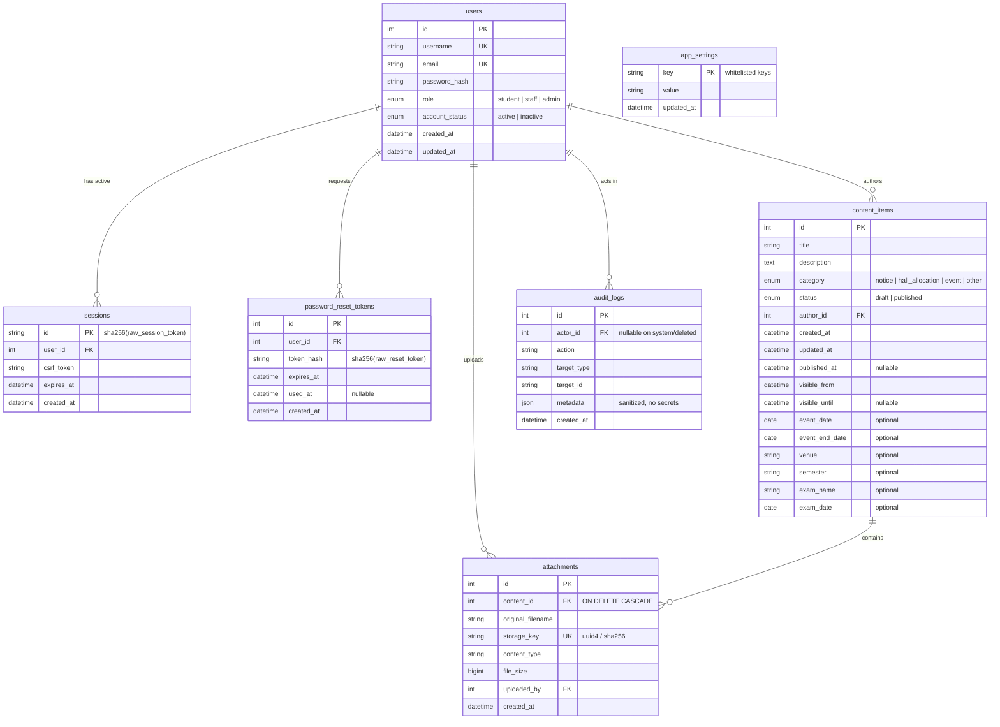
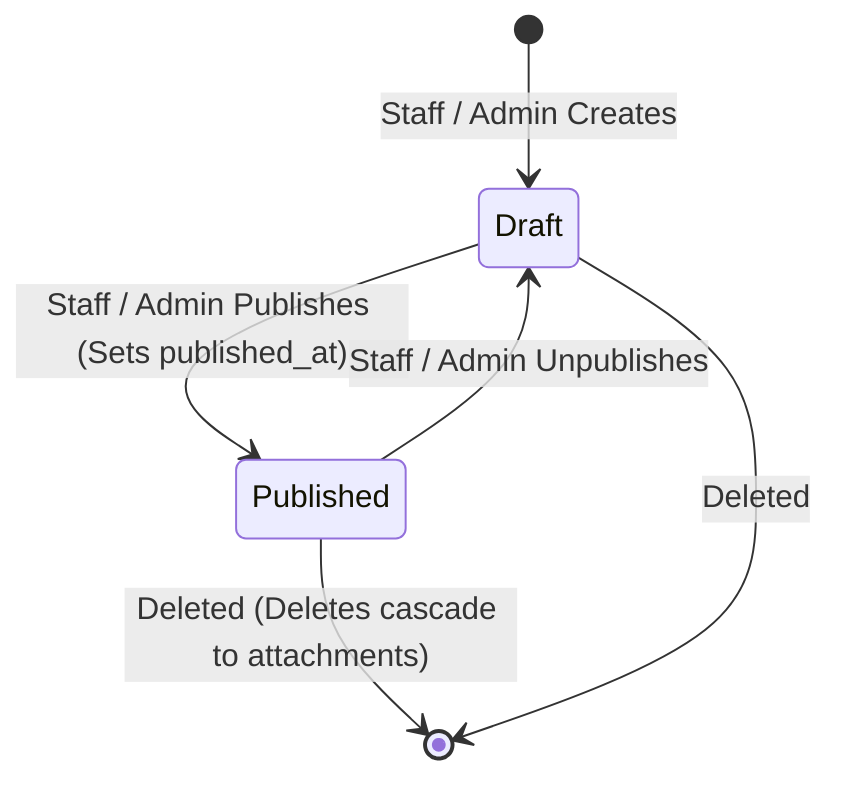

# CampusConnect Database Schema Specification

## 1. Relational Schema Diagram (ERD)



## 2. Table Specifications & Indexes

### Table: `users`
- `id`: `INTEGER PRIMARY KEY GENERATED ALWAYS AS IDENTITY`
- `username`: `VARCHAR(50) NOT NULL UNIQUE`, Indexed
- `email`: `VARCHAR(255) NOT NULL UNIQUE`, Indexed
- `password_hash`: `VARCHAR(255) NOT NULL` (Argon2id format)
- `role`: `VARCHAR(20) NOT NULL` (`student`, `staff`, `admin`)
- `account_status`: `VARCHAR(20) NOT NULL DEFAULT 'active'` (`active`, `inactive`)
- `created_at`: `TIMESTAMPTZ NOT NULL DEFAULT NOW()`
- `updated_at`: `TIMESTAMPTZ NOT NULL DEFAULT NOW()`
- **Indexes**:
  - `idx_users_username` ON `(username)`
  - `idx_users_email` ON `(email)`
  - `idx_users_role` ON `(role)`
  - `idx_users_status` ON `(account_status)`

### Table: `sessions`
- `id`: `VARCHAR(64) PRIMARY KEY` (SHA-256 digest of client session cookie)
- `user_id`: `INTEGER NOT NULL REFERENCES users(id) ON DELETE CASCADE`
- `csrf_token`: `VARCHAR(64) NOT NULL`
- `expires_at`: `TIMESTAMPTZ NOT NULL`
- `created_at`: `TIMESTAMPTZ NOT NULL DEFAULT NOW()`
- **Indexes**:
  - `idx_sessions_user_id` ON `(user_id)`
  - `idx_sessions_expires_at` ON `(expires_at)`

### Table: `password_reset_tokens`
- `id`: `INTEGER PRIMARY KEY GENERATED ALWAYS AS IDENTITY`
- `user_id`: `INTEGER NOT NULL REFERENCES users(id) ON DELETE CASCADE`
- `token_hash`: `VARCHAR(64) NOT NULL UNIQUE` (SHA-256 digest of client token)
- `expires_at`: `TIMESTAMPTZ NOT NULL` (Current time + 30 min)
- `used_at`: `TIMESTAMPTZ NULL`
- `created_at`: `TIMESTAMPTZ NOT NULL DEFAULT NOW()`
- **Indexes**:
  - `idx_reset_token_hash` ON `(token_hash)`
  - `idx_reset_user_id` ON `(user_id)`

### Table: `content_items` (Notices, Events, Hall Allocations)
- `id`: `INTEGER PRIMARY KEY GENERATED ALWAYS AS IDENTITY`
- `title`: `VARCHAR(255) NOT NULL`
- `description`: `TEXT NOT NULL` (Plain text sanitized)
- `category`: `VARCHAR(30) NOT NULL` (`notice`, `hall_allocation`, `event`, `other`)
- `status`: `VARCHAR(20) NOT NULL DEFAULT 'draft'` (`draft`, `published`)
- `author_id`: `INTEGER NOT NULL REFERENCES users(id) ON DELETE RESTRICT`
- `created_at`: `TIMESTAMPTZ NOT NULL DEFAULT NOW()`
- `updated_at`: `TIMESTAMPTZ NOT NULL DEFAULT NOW()`
- `published_at`: `TIMESTAMPTZ NULL`
- `visible_from`: `TIMESTAMPTZ NOT NULL DEFAULT NOW()`
- `visible_until`: `TIMESTAMPTZ NULL`
- `event_date`: `DATE NULL`
- `event_end_date`: `DATE NULL`
- `venue`: `VARCHAR(255) NULL`
- `semester`: `VARCHAR(50) NULL`
- `exam_name`: `VARCHAR(150) NULL`
- `exam_date`: `DATE NULL`
- **Indexes**:
  - `idx_content_status_visibility` ON `(status, visible_from, visible_until)`
  - `idx_content_category` ON `(category)`
  - `idx_content_updates` ON `(status, published_at, updated_at)`

### Table: `attachments`
- `id`: `INTEGER PRIMARY KEY GENERATED ALWAYS AS IDENTITY`
- `content_id`: `INTEGER NOT NULL REFERENCES content_items(id) ON DELETE CASCADE`
- `original_filename`: `VARCHAR(255) NOT NULL`
- `storage_key`: `VARCHAR(128) NOT NULL UNIQUE`
- `content_type`: `VARCHAR(100) NOT NULL`
- `file_size`: `BIGINT NOT NULL`
- `uploaded_by`: `INTEGER NOT NULL REFERENCES users(id) ON DELETE RESTRICT`
- `created_at`: `TIMESTAMPTZ NOT NULL DEFAULT NOW()`
- **Indexes**:
  - `idx_attachments_content_id` ON `(content_id)`
  - `idx_attachments_storage_key` ON `(storage_key)`

### Table: `audit_logs`
- `id`: `INTEGER PRIMARY KEY GENERATED ALWAYS AS IDENTITY`
- `actor_id`: `INTEGER NULL REFERENCES users(id) ON DELETE SET NULL`
- `action`: `VARCHAR(50) NOT NULL`
- `target_type`: `VARCHAR(50) NOT NULL`
- `target_id`: `VARCHAR(100) NOT NULL`
- `metadata`: `JSONB NOT NULL DEFAULT '{}'::jsonb`
- `created_at`: `TIMESTAMPTZ NOT NULL DEFAULT NOW()`
- **Indexes**:
  - `idx_audit_actor_id` ON `(actor_id)`
  - `idx_audit_action` ON `(action)`
  - `idx_audit_created_at` ON `(created_at)`

### Table: `app_settings`
- `key`: `VARCHAR(100) PRIMARY KEY`
- `value`: `TEXT NOT NULL`
- `updated_at`: `TIMESTAMPTZ NOT NULL DEFAULT NOW()`

---

## 3. State Transitions & Visibility Rules



### Student Visibility Filter
For students querying `/api/content` or `/api/updates`:
```sql
WHERE status = 'published'
  AND visible_from <= NOW()
  AND (visible_until IS NULL OR visible_until >= NOW())
```

### "New Updates" Ordering
```sql
ORDER BY GREATEST(COALESCE(published_at, created_at), updated_at) DESC
```
